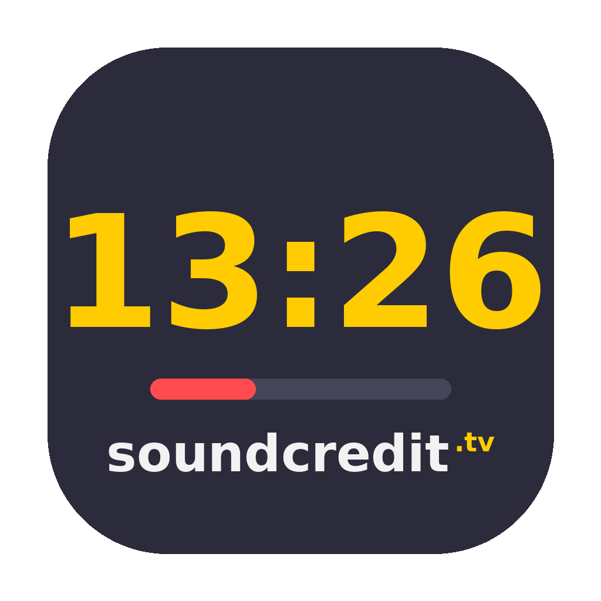

# StageCredit

Stage timer by [Sound Credit TV](https://soundcredit.tv). A control panel for the operator, a big clean countdown for the presenter.



## Features

- **Two output views** — a presenter display (name, subtitle, messages, next up) and a stripped clock-only view for FOH or confidence, each fullscreen on any connected screen. Both remember where they were between launches
- **Cue list** — named cues with drag-and-drop reordering and a full editor: countdown / count-up / time-of-day types, per-cue colours and background tints, speaker names shown on the display, per-cue warning thresholds, overtime rules (count up or hold at 0:00), auto-follow chaining, scheduled starts at a time of day, automatic wrap-up messages, and operator-only notes
- **GO and arming** — GO loads and starts the next cue; digits 1–9 arm a cue without touching the output, so a stray keypress can't stop a live clock
- **Messages** — one-off custom messages plus unlimited saved presets; send/clear from a single toggling button
- **Blackout** — hold to blank the output, tap to bring it back. Deliberate to blank, instant to restore
- **Backtiming** — set a planned start and a hard out; the panel shows projected finish, drift against plan, slack to the hard out, and a projected clock time against every cue. Re-times live as you overrun
- **LAN remote** — start the built-in server and any phone or laptop on the venue network can open the display, the clock view, or a token-gated remote. A small HTTP action API drives it from Bitfocus Companion
- **As-run log** — every load, start, pause, reset and blackout written from the main process as it happens, with planned-vs-actual per cue. Survives a force-quit; exports to CSV
- **Show lock** — freezes the rundown against accidental edits, optionally on the first GO
- **Customise** — font, timer size, all colours, custom logo upload, flash-at-zero, 12/24-hour clock, corner time-of-day clock, and a "next up" band with its own position and size
- **Simple mode** — strips back to a timer and a display: no cues, messages, backtiming or clock speed
- **CSV rundown import** — bring a running order in from a spreadsheet, with a downloadable template. Append or replace, with a per-row preview before anything is applied
- **Undo** — 12 deep over cues and presets, including New and Load Show. Never interrupts a running clock
- **Keyboard shortcuts** — fully remappable in-app (Space start/pause, R reset, T time-of-day, arrows for quick time adds, C clear message), plus digits 1–9 (0 for cue 10) to arm a cue and ⌘Z to undo
- **Show files** — save/load the entire show (cues, messages, styling, shortcuts, planned start and hard out) as a portable `.stagecredit` JSON file
- **Clock speed** — runs each on-screen second at 0.8×–1.2×. For schedule correction. Obviously.

## Development

Requires [Node.js](https://nodejs.org) (LTS).

```bash
npm install     # first time only
npm start       # run the app
```

## Building installers

```bash
npm run dist        # macOS DMG (universal)
npm run dist:win    # Windows installer + portable exe
npm run dist:all    # both
```

Output lands in `dist/`. Builds are unsigned: macOS needs right-click → Open on first launch; Windows SmartScreen needs More info → Run anyway.

## Project layout

| File | Purpose |
|---|---|
| `main.js` | Electron main process — windows, display picker, state persistence, show file dialogs |
| `preload-control.js` / `preload-display.js` | Least-privilege IPC bridges (legacy `preload.js` re-exports control) |
| `control.html` + `control-app.js` + `control.css` | Operator control panel (timer engine, UI, network controls) |
| `control-legacy.html` | The pre-redesign control panel, kept for reference. Not loaded, not shipped. |
| `display.html` + `display-app.js` + `display.css` | Presenter display — also served over the LAN as `/display` and `/clock` |
| `remote.html` + `remote-app.js` + `remote.css` | Phone remote, served at `/remote` behind the session token |
| `server.js` | LAN HTTP + WebSocket server and the Companion action API |
| `asrun.js` | As-run log, appended from the main process as JSON Lines |
| `fonts/` | Montserrat, bundled locally (SIL OFL 1.1 — licence included) so launch never waits on the network |
| `build/icon.png` | App icon (13:26 — if you know, you know) |
| `stagecredit-rundown-template.csv` | The CSV import template, also downloadable from the app |
| `StageCredit User Guide.pdf` | Branded user guide for the crew |
| `tools-make-guide.py` | Regenerates that guide — `pip install reportlab && python3 tools-make-guide.py`. Bump `VERSION` at the top when you cut a release |

Pages ship external scripts and stylesheets. Control keeps a tiny boot `<style>` and layout
`style=` attributes (so its CSP still allows style-src `'unsafe-inline'`); display/remote CSS
is pure external files with style-src `'self'` only. LAN serving allow-lists only the
display/remote JS+CSS assets plus fonts and the logo endpoint.

Cues, messages, settings, and shortcuts persist per-user via `localStorage`; the display
windows' position/fullscreen state and the as-run log live in the app's user data folder.

## Remote API

The server is off by default. Start it from Settings → Network; the panel shows the URLs
and the session token. Viewer paths are open (worst case someone on the venue network
watches your countdown); anything that can change the output needs the token.

| Path | Auth | Purpose |
|---|---|---|
| `/display`, `/clock` | open | The two output views in a browser (intentional open viewers on venue LAN) |
| `/remote` | token (+ Origin must match Host if sent) | Phone remote |
| `/api/action?a=…&t=…` | token (+ Origin match if sent) | Single action, GET or POST (Companion-friendly). Response includes `applied` |
| `/api/state?t=…` | token (+ Origin match if sent) | Current state and cue list as JSON |
| `/api/health` | open | Liveness check |

Actions: `start`, `pause`, `toggle`, `reset`, `tod`, `blank`, `blankon`, `blankoff`,
`go`, `next`, `prev`, `cue`, `add`, `set`, `message`, `clearmessage`, `preset`.
Values go in `v` — e.g. `?a=add&v=60` adds a minute.

Cue and preset numbers are **1-based**, matching the numbers shown down the cue list:
`?a=cue&v=1` loads the first cue.

## Versioning

Bump `version` in `package.json` before building a release. Current: **1.0.2**.

### 1.0.2

- Remote and Companion `blank` / `blankon` / `blankoff` work again — they were clicking a button that only answers to press-and-hold, so they failed silently
- Show files now carry the planned start and hard out. Loading a show replaces the plan left on that machine; New Show clears it; undo restores it. Drift was previously measured against whatever schedule was last used on that rig
- Deleting the loaded cue no longer strands the output in time-of-day or count-up with nothing loaded
- Auto messages fire on cues shorter than their trigger (a 30s cue with the default 120s trigger used to do nothing at all)
- As-run entries close when a cue is cleared or deleted, not only when the next one loads, so actual durations no longer absorb the gap
- Clock hand-off to manual can't write `1:60` into the mm/ss boxes
- Drift reads `on plan` before the show starts instead of "hours ahead"
- Cue and preset numbers in the remote API are 1-based, matching the UI
- A display remembered as a *window* on a since-disconnected screen no longer reopens off-screen

---

Built by Sound Credit TV.
